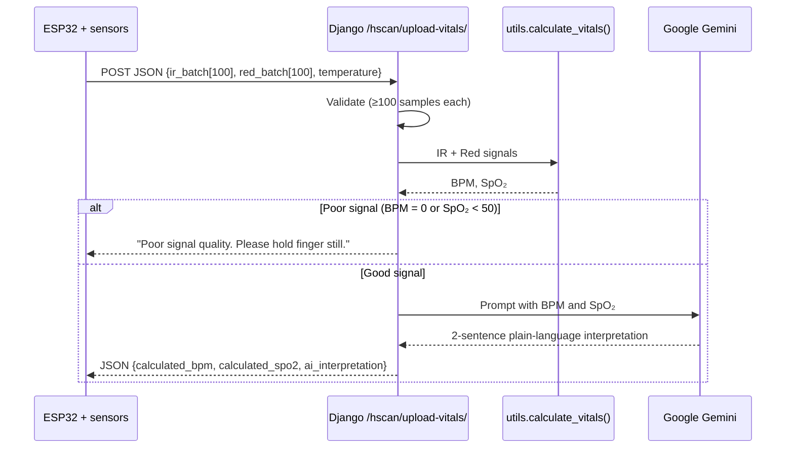

# AI-Powered Health Monitoring System — Software (Auratrack)

**Auratrack** is the Django backend of an AI-powered health monitoring system. It receives raw pulse-sensor data from an **ESP32** over a REST endpoint, calculates **heart rate (BPM)** and **blood-oxygen saturation (SpO₂)** with signal processing (NumPy and SciPy), and asks **Google Gemini** to explain the result in plain language that anyone can understand.

> This repository is the **software** part. The ESP32 firmware and sensor wiring are in the hardware repository: [kanyi-Gabriel/Healt_hardware](https://github.com/kanyi-Gabriel/Healt_hardware).

---

## Table of contents

- [How it works](#how-it-works)
- [Tech stack](#tech-stack)
- [Repository structure](#repository-structure)
- [Setup and installation](#setup-and-installation)
- [API reference](#api-reference)
- [How the vitals are calculated](#how-the-vitals-are-calculated)
- [Testing the API manually](#testing-the-api-manually)
- [Known issues](#known-issues)
- [Roadmap](#roadmap)
- [License](#license)

---

## How it works



1. The ESP32 collects 100 infrared (IR) and 100 red-light samples from a MAX30102 sensor and POSTs them as JSON.
2. Django checks there are at least 100 samples of each.
3. `calculate_vitals()` estimates heart rate from peaks in the IR signal and SpO₂ from the ratio of red to IR light absorption.
4. If the signal looks bad, the API asks the user to hold their finger still instead of returning misleading numbers.
5. Otherwise, Gemini receives a prompt with the vitals and returns a short explanation, including whether they're in normal ranges and a reminder that it's an AI, not a doctor.

## Tech stack

| Layer | Technology |
|---|---|
| Web framework | Django |
| Signal processing | NumPy, SciPy (`find_peaks`) |
| AI interpretation | Google Gemini (`gemini-2.5-flash`) via `google-generativeai` |
| Database | SQLite (Django default) |
| Containerisation | Docker |
| Device | ESP32 + MAX30102 + DS18B20 ([hardware repo](https://github.com/kanyi-Gabriel/Healt_hardware)) |

## Repository structure

```
AI-powered-Health-Monitoring/
├── Auratrack/                 # Django project root
│   ├── Auratrack/             # Project settings
│   │   ├── settings.py
│   │   ├── urls.py            # Routes /hscan/ to the hscan app
│   │   ├── asgi.py
│   │   └── wsgi.py
│   ├── hscan/                 # "Health scan" app
│   │   ├── views.py           # process_sensor_data: validation, DSP, Gemini call
│   │   ├── utils.py           # calculate_vitals: heart rate and SpO₂ from raw signals
│   │   ├── urls.py            # upload-vitals/ endpoint
│   │   ├── models.py
│   │   └── tests.py
│   ├── manage.py
│   ├── requirements.txt
│   ├── .env.example           # Template for the git-ignored .env secrets file
│   └── Dockerfile
├── .gitignore
├── LICENSE
└── README.md
```

## Setup and installation

### Prerequisites

- Python 3.12 or newer (required by Django 6)
- A Google Gemini API key from [Google AI Studio](https://aistudio.google.com/app/apikey)
- (Optional) Docker

### 1. Clone and create a virtual environment

```bash
git clone https://github.com/kanyi-Gabriel/AI-powered-Health-Monitoring.git
cd AI-powered-Health-Monitoring/Auratrack

python3 -m venv venv
source venv/bin/activate        # Windows: venv\Scripts\activate
```

### 2. Install dependencies

```bash
pip install -r requirements.txt
```

### 3. Configure your secrets

Secrets are read from a `.env` file, which is git-ignored so it never gets committed. Copy the template:

```bash
cp .env.example .env
```

Then open `.env` and fill in the values:

| Variable | What to put |
|---|---|
| `DJANGO_SECRET_KEY` | A long random string. Generate one with `python3 -c "import secrets; print(secrets.token_urlsafe(50))"` |
| `DJANGO_DEBUG` | `True` for local development, `False` anywhere else |
| `GEMINI_API_KEY` | Your key from Google AI Studio |

### 4. Run the server

```bash
python manage.py migrate
python manage.py runserver 0.0.0.0:8000
```

`0.0.0.0` makes the server reachable from the ESP32 on the same Wi-Fi network. Put your computer's local IP address (from `ipconfig` or `ip addr`) into `serverUrl` in the ESP32 sketch.

### Run with Docker

```bash
cd Auratrack
docker build -t auratrack .
docker run -p 8000:8000 --env-file .env auratrack
```

## API reference

### `POST /hscan/upload-vitals/`

**Request**

```http
POST /hscan/upload-vitals/
Content-Type: application/json
```

```json
{
  "ir_batch":  [112034, 112101, 111987, "... at least 100 integers"],
  "red_batch": [98012,  98110,  97950,  "... at least 100 integers"],
  "temperature": 36.4
}
```

| Field | Required | Description |
|---|---|---|
| `ir_batch` | Yes | Raw infrared readings, at least 100 values |
| `red_batch` | Yes | Raw red-light readings, at least 100 values |
| `temperature` | No | Body temperature in °C from the DS18B20 (sent by the device, not used yet) |

**Responses**

| Case | HTTP status | Body |
|---|---|---|
| Success | `200` | `{"status": "success", "calculated_bpm": 76.9, "calculated_spo2": 97.2, "ai_interpretation": "..."}` |
| Poor signal (BPM = 0 or SpO₂ < 50) | `200` | `{"status": "error", "message": "Poor signal quality. Please hold finger still."}` |
| Fewer than 100 samples | `400` | `{"error": "Need at least 100 data points for accurate DSP"}` |
| Method other than POST | `405` | `{"error": "Only POST allowed"}` |
| Invalid JSON, Gemini failure or other error | `500` | `{"error": "<details>"}` |

Example success response:

```json
{
  "status": "success",
  "calculated_bpm": 76.9,
  "calculated_spo2": 97.2,
  "ai_interpretation": "Your heart rate of 76.9 BPM and oxygen level of 97.2% are both within normal resting ranges. Remember, I'm an AI and not a doctor, so consult a healthcare professional for medical advice."
}
```

## How the vitals are calculated

All signal processing is in `hscan/utils.py`.

**Heart rate.** SciPy's `find_peaks` finds pulse peaks in the IR signal. Peaks must be at least 40 samples apart (0.4 s), which caps the reading at 150 BPM. The average gap between peaks gives the beat interval:

```
BPM = 60 / (average peak interval in seconds)
```

**SpO₂.** Oxygen-rich blood absorbs infrared and red light differently. The pulsing (AC) part of each signal is divided by its steady (DC) part, and the two are compared:

```
R    = (red_AC / red_DC) / (IR_AC / IR_DC)
SpO₂ = A − B × R           (capped to 0–100%)
```

`A` and `B` are calibration constants. A common starting point from sensor application notes is `A = 104`, `B = 17`.

> **Disclaimer:** This is a learning project, not a medical device. The readings haven't been validated against clinical equipment and must not be used for diagnosis.

## Testing the API manually

With the server running, send a fake batch from a terminal:

```bash
python - <<'EOF'
import json, math, urllib.request
t = [i / 100 for i in range(300)]          # 3 s at 100 Hz
ir  = [int(110000 + 800 * math.sin(2 * math.pi * 1.25 * x)) for x in t]   # 75 BPM
red = [int(90000  + 440 * math.sin(2 * math.pi * 1.25 * x)) for x in t]
body = json.dumps({"ir_batch": ir, "red_batch": red, "temperature": 36.5}).encode()
req = urllib.request.Request("http://127.0.0.1:8000/hscan/upload-vitals/", body,
                             {"Content-Type": "application/json"})
print(urllib.request.urlopen(req).read().decode())
EOF
```

Other cases worth checking:

| Test | Expected |
|---|---|
| `GET /hscan/upload-vitals/` | `405` |
| Only 50 samples | `400` |
| Flat signal (all values equal) | Poor-signal message |
| Body that isn't valid JSON | Error response |
| Gemini key missing or invalid | Error response |

## Known issues

These were found by testing `calculate_vitals()` with synthetic pulse signals of known heart rate and oxygen level.

1. **SpO₂ always reads 100%.** The formula uses `104 - 1.17 * R`. For any realistic `R` (0.4–1.5) this gives about 102–103, which is then capped at 100, so low oxygen is never detected. The constant is most likely meant to be `17`.
2. **Heart rate is unreliable with 1 second of data.** 100 samples hold only one or two beats. In testing, a 60 BPM signal was read as 82–90 BPM, and a 75 BPM signal was once read as 150 BPM. A 4–5 second window and a band-pass filter before peak detection would make it far more stable.
3. **Sample rate is assumed, not measured.** The code assumes exactly 100 Hz, but the ESP32's real rate depends on loop timing. Sending timestamps or the measured rate would fix the BPM scale.
4. **Temperature is ignored.** The device sends it, but the server doesn't read it, show it, or include it in the Gemini prompt.
5. **Readings aren't saved.** There are no database models yet, so there's no history.
6. **Poor-signal responses return HTTP 200.** A `422` would let clients tell failures apart by status code.
7. **Invalid JSON returns 500.** It should return `400`, since it's a client error.
8. **No automated tests yet.** `hscan/tests.py` is empty.

## Roadmap

- [ ] Fix the SpO₂ constant and add unit tests for `calculate_vitals()`
- [ ] Longer sampling window and band-pass filtering for heart rate
- [ ] Use temperature in the response and the AI prompt
- [ ] `Reading` model to store vitals history
- [ ] Web dashboard showing live and past readings with the AI explanation
- [ ] Device authentication (API key or token) and HTTPS
- [x] Move secrets (`SECRET_KEY`, `GEMINI_API_KEY`) to a git-ignored `.env` file
- [ ] Migrate from `google-generativeai` to Google's newer `google-genai` SDK

## License

This project is licensed under the [MIT License](LICENSE).

## Author

**Gabriel Kanyi** — Electrical & Electronic Engineer | Data Scientist
[GitHub](https://github.com/kanyi-Gabriel) · kanyiegabriel@gmail.com
